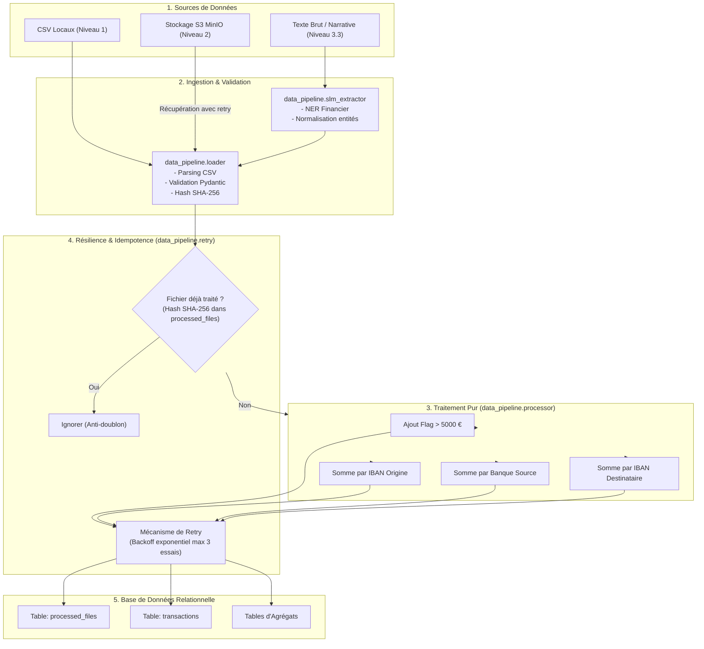
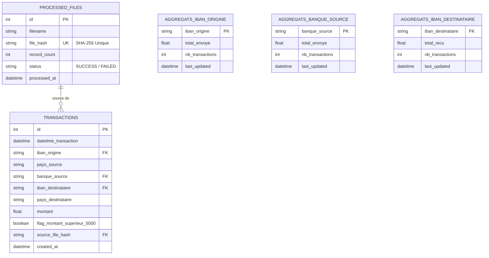

# Architecture Technique & Conception Détaillée

Ce document présente l'architecture globale, les choix de conception, le modèle relationnel et les mécanismes de résilience mis en œuvre dans le projet.

---

## 1. Flux Général des Données

---

## 2. Modèle de Données Relationnel

La base de données relationnelle est conçue pour stocker les transactions individuelles, historiser les fichiers ingérés pour garantir l'idempotence, et maintenir à jour les tables d'agrégation.

---

## 3. Contraintes de Pureté des Fonctions (Niveau 1.2)

Toutes les fonctions du module [`data_pipeline.processor`](file:///data_pipeline/processor.py) répondent rigoureusement aux 3 critères de pureté logicielle :
1. **Immutabilité des entrées** : les structures reçues en argument (`transactions: list`) ne sont jamais mutées. De nouvelles instances de dictionnaires ou de modèles Pydantic `ProcessedTransaction` sont instanciées.
2. **Absence d'état externe** : aucune variable globale, lecture de base de données, appel réseau ou interaction avec le système de fichiers n'a lieu au sein des calculs.
3. **Déterminisme strict** : pour un ensemble de transactions d'entrée identique, la fonction renvoie invariablement le même résultat au centime près.

---

## 4. Garantie d'Anti-Doublons et Idempotence

Le traitement d'un fichier peut échouer à mi-parcours ou être relancé plusieurs fois par un scheduler. Pour éviter l'insertion de doublons :
- Un **hash SHA-256** unique du contenu du fichier est calculé dès le chargement (`compute_content_hash`).
- Avant toute insertion, une requête vérifie l'existence de ce hash dans la table `processed_files`.
- Si le hash est déjà présent avec le statut `SUCCESS`, l'insertion est **immédiatement ignorée** avec le statut `SKIPPED`, et aucune transaction n'est dupliquée.
- L'insertion des transactions, la mise à jour des agrégats et l'enregistrement du hash sont encapsulés dans une **transaction SQL unique** (`BEGIN ... COMMIT`) assurant l'atomicité (`ACID`).

---

## 5. Résilience et Retry avec Exponential Backoff

Le décorateur [`@with_retry`](file:///data_pipeline/retry.py) encapsule :
- Les insertions en base de données relationnelle (`insert_processed_data_with_retry`).
- Les téléchargements depuis le service compatible S3 (`get_s3_file_content_with_retry`).

### Formule de temporisation
$$\text{Délai} = \text{initial\_delay} \times (\text{backoff\_factor})^{\text{tentative} - 1}$$

Par exemple :
- Tentative 1 : Échec -> Attente de `0.5s`
- Tentative 2 : Échec -> Attente de `1.0s`
- Tentative 3 : Échec -> Arrêt propre et levée de l'exception `MaxRetriesExceededError`.
